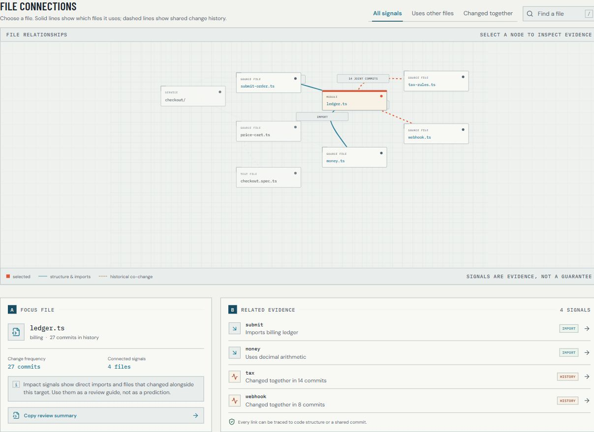
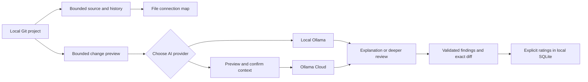
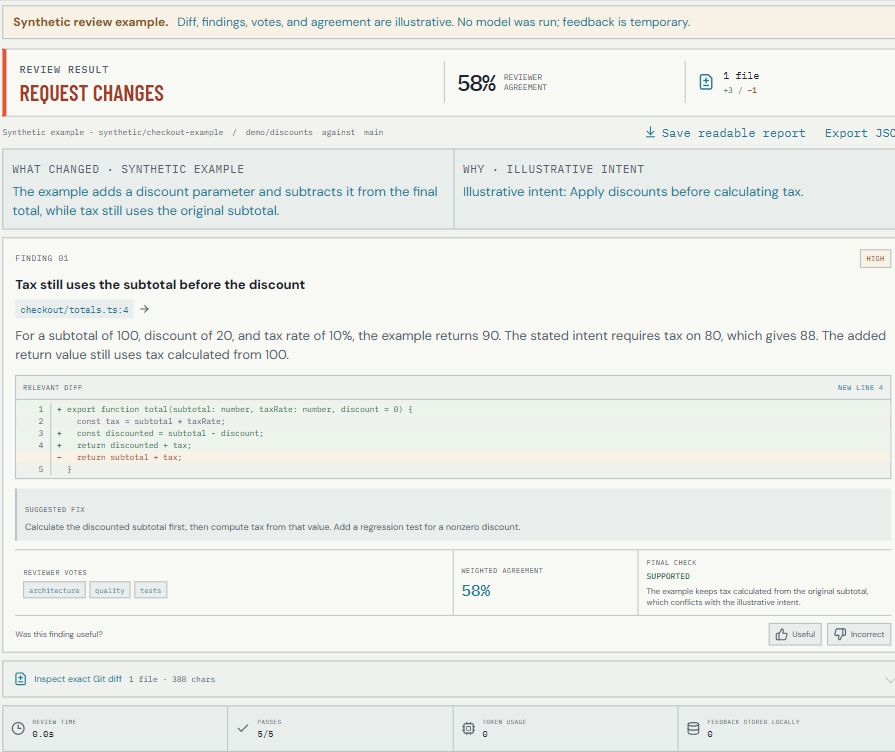

# Stxic Atlas

**Understand what a code change touches—and inspect the evidence behind it.**

A local-first code explorer with a file connection map, plain-language AI explanations, and optional deeper change review. Built as a full-stack engineering portfolio project using React, TypeScript, Express, Git, Ollama, and SQLite.

[Explore the public demo](https://stxic-atlas.vercel.app) · [Run locally](#run-locally) · [Set up AI](#set-up-ai) · [Architecture](ARCHITECTURE.md)

The public website is a **synthetic interactive walkthrough**. To scan your own repository or use AI, run the local app. All example names, people, counts, code, and findings are fictional.



## What it does

Stxic Atlas helps developers and people reviewing their work answer: **“If this file changes, what else should I check?”**

| Tool | What you see | Source |
| --- | --- | --- |
| File connections | Direct imports and files that repeatedly changed together | Current source and bounded Git history; deterministic evidence |
| Check changes | Changed files, line counts, and an inspectable diff | Git; no AI required |
| Explain with AI | What changed, why it matters, and suggested checks tied to changed lines | One model pass; interpretation |
| Run deeper review | Specialist findings, reviewer agreement, final verdicts, and supporting code | Five focused passes and a skeptical final reviewer; interpretation |

You can inspect and export evidence, save readable reports, and explicitly rate review findings. Incomplete reviews remain visibly incomplete.

## Why this project exists

A diff shows the edited lines, but the next review question often lives elsewhere: which file imports this module, which test usually changes with it, or which contract deserves another look? Import relationships and shared commit history provide different clues. Keeping them together makes those follow-up questions easier to investigate.

AI adds a second challenge: a confident explanation is difficult to trust when its evidence is hidden. Stxic exposes the changed code, separates repository facts from model interpretation, and preserves failures instead of turning missing work into a clean result.

The engineering goal was to build a useful local workflow across repository analysis, model orchestration, accessible UI, and explicit data boundaries. An AI review is a fallible aid to human inspection, not approval.

## How it works



The analyzer reads imports and recent Git history without executing repository code. AI receives the bounded diff, optional change intent, recent commit subjects, and allowlisted project notes. Model replies are validated against changed files and lines before reaching the interface.

Deeper review uses security, architecture, quality, testing, and performance perspectives. Findings are grouped and weighted; a final reviewer challenges them against the same diff. These are separate passes of the selected model, rather than five independently trained models. Agreement is a review signal, not a calibrated probability of correctness.

### Engineering decisions

| Decision | Why | Implementation |
| --- | --- | --- |
| Local repository service | A public browser cannot directly read a visitor's project folders | [API](server/index.ts), [repository boundaries](server/repository.ts) |
| Separate source/history signals | Imports and repeated co-changes answer different questions | [Impact analyzer](server/analyze.ts) |
| Explanation before deeper review | A short explanation can help without waiting for six model calls | [Workflow UI](src/ReviewPanel.tsx), [orchestration](server/review.ts) |
| Citations and partial results | Failed passes and truncated diffs must not resemble a completed clean review | [Types](src/types.ts), [response guards](src/api.ts) |
| Explicit cloud consent | Users should know exactly which context leaves their computer | [Transport](server/ai.ts), [disclosure checks](server/review.ts) |
| Bounded human feedback | Ratings tune reviewer influence without claiming model training | [SQLite and weighting](server/review.ts) |
| Separate static landing build | The public presentation must not expose the local API | [Landing page](landing/), [Vercel configuration](vercel.json) |

### A concrete example

The built-in **synthetic** review illustrates a discount calculation. Its stated intent is to apply discounts before tax. The edited function subtracts the discount from the returned total, while tax still uses the original subtotal.

With an illustrative subtotal of 100, a discount of 20, and 10% tax, that code returns 90; the stated intent expects 88. The finding cites `checkout/totals.ts:4` and exposes the exact diff so the reader can verify the reasoning.

This is authored sample data. No model runs when it is loaded, and its ratings do not change stored reviewer weights.

<details>
<summary>See the synthetic change-review walkthrough</summary>



</details>

## Run locally

**Requirements:** Node.js **22.13 or newer**, Git, and a local Git project. Ollama is optional unless you want local AI.

```sh
git clone https://github.com/clascuna556171/stxic-atlas.git
cd stxic-atlas
npm ci
npm run dev
```

Open **http://127.0.0.1:5175/**. The app starts with a synthetic map. Development uses a fixed port and reports a conflict if another process occupies it.

1. Choose **Browse folders** on Windows, or paste an absolute local path. A subfolder resolves to its enclosing Git project.
2. Use **File connections** to inspect imports and shared change history.
3. Open **AI change review → Check changes** to preview edits without AI.
4. Choose **Current edits**, **Latest saved version**, or **Advanced comparison**. AI review needs a saved Git baseline; the latest-version comparison needs at least two commits and includes current edits too.

Without a model, **Explore example review** still works. Light, Dark, and Auto appearance are available throughout the app.

## Set up AI

| Mode | Requirements | Code processing |
| --- | --- | --- |
| No AI | Running local app and Git project | On your computer |
| Local AI — default | Ollama running with an installed local chat model | `127.0.0.1:11434` |
| Optional cloud AI | Running local app, internet access, your own Ollama Cloud key and model access | Ollama Cloud after context confirmation |

### Local Ollama

1. [Download Ollama](https://ollama.com/download) and start it. If its service is not already running, use `ollama serve`.
2. Download a local chat model that fits your hardware. For example, [Qwen 3.5 9B](https://ollama.com/library/qwen3.5:9b):

   ```sh
   ollama pull qwen3.5:9b
   ollama list
   ```

3. In **AI change review**, select **On this computer**, click **Refresh AI list**, and choose the installed model. The interface reports **Local model ready** when a usable model is available.
4. Choose a Git project, click **Check changes**, then **Explain with AI**. **Run deeper review** is a separate action.

Local inference needs no API key. Model size affects memory use and waiting time; small models can misread code. See [Ollama's official setup guide](https://docs.ollama.com/quickstart). Stxic excludes remote/cloud-tagged models from the local list.

### Optional Ollama Cloud

1. Create your own key in [Ollama account settings](https://ollama.com/settings/keys).
2. In the local app, select **Where AI runs → Ollama Cloud**, connect the key, and choose a listed model. This direct cloud route does not require a local Ollama installation.
3. Start an explanation or deeper review. Inspect the outgoing filenames, project notes, and exact bounded context, then explicitly confirm consent.

Cancel or Escape sends no inference request. Changed context requires another preview. A saved key/catalog does not guarantee model access; account or allowance errors offer recovery guidance. Provider usage limits apply; see [Ollama Cloud](https://docs.ollama.com/cloud).

Keys stay in local server memory until disconnect or restart. They are not saved in browser storage, reports, SQLite, or source control. Providers never switch automatically.

## Privacy and boundaries

- **Scanning and change previews:** local Git/source reads; no repository code execution or upload during scanning.
- **Local AI:** bounded context goes only to local Ollama. **Selected cloud AI:** confirmed context goes to Ollama Cloud.
- **Storage:** recent project paths and appearance in browser storage; review metadata and explicit feedback in local SQLite. SQLite does not store source, diffs, or finding prose. Windows uses `%LOCALAPPDATA%\.change-atlas\feedback.sqlite`; otherwise `~/.change-atlas/feedback.sqlite` is used when `LOCALAPPDATA` is unset.
- **HTTP boundary:** loopback binding, Host/Origin checks, cross-site rejection, and JSON-only API POSTs. The service is intended for local use.
- **Untrusted context:** documents, diffs, and commit messages are model context, never system instructions.

Reads, Git output, history, request payloads, and review context are bounded. Symlinked source paths are skipped. Feedback adjusts bounded reviewer weights; it does not train models or rewrite prompts.

## Trade-offs and current limits

- The map considers up to **400 commits** and **140 tracked source files**, displaying up to **28 files**. Co-change pairs use at most 60 source files per commit.
- Import detection is pattern-based, primarily JavaScript/TypeScript-style relative imports and relative/local-package Dart imports. Other supported languages contribute history signals; this is not a complete dependency parser.
- AI receives at most **38,000 diff characters**. Omitted source, truncation, malformed replies, and failed passes produce an incomplete result.
- Invalid model findings or citations also make a review incomplete; valid findings remain inspectable.
- Projects whose tracked files use Git clean/process filters (including Git LFS) cannot use change previews or AI review. Stxic stops before executing those helpers; use a separate checkout without the filters. File connections still work, and unrelated projects with unused global filters remain supported. The app never changes Git settings.
- Connections suggest where to investigate. AI can miss defects or propose incorrect findings even when every pass completes.
- Webhooks, GitHub review comments, CI review integration, model training, and automatic prompt evolution are not implemented.

## Verification

```sh
npm test
npm run build
npm run build:landing
npm run smoke:install
npm audit
```

Tests use disposable synthetic Git repositories, mocked model replies, and an isolated SQLite store. They cover evidence, file boundaries, malformed/partial results, cloud consent, provider failures, feedback, and stale requests. The dated [verification record](docs/verification.md) lists checks actually run and their limits.

`smoke:install` requires the local production build and an unused port 4317. It starts an isolated local service, checks the built page and API, scans a disposable synthetic Git project, and previews a change without AI. It then removes its temporary data.

The [release-check workflow](.github/workflows/ci.yml) configures fresh installs and checks on Windows, macOS, and Linux using Node 22.13.0 and 24. Its first remote run must pass before a release; adding the workflow does not establish platform compatibility. See the [release checklist](docs/release.md).

For an **actual installed local model** check:

```sh
npm run smoke:review -- qwen3.5:9b
```

This opt-in run saves a synthetic checkout, isolated database, and report under ignored `.test-data/`. It checks orchestration, not finding accuracy.

## Public landing page

The [Vercel site](https://stxic-atlas.vercel.app) introduces the product with a synthetic map and review. It cannot read visitor folders and performs no AI inference.

```sh
npm run dev:landing       # http://127.0.0.1:5176/
npm run build:landing     # static dist-landing/ output
npm run preview:landing   # preview the production build
```

`vercel.json` selects the landing build; `npm run build` remains the local-app build. Fonts and examples are bundled. `.vercelignore` excludes the backend, local data, tests, and documentation assets from deployment uploads. Publish from an authorized account with `npx vercel deploy --prod --project stxic-atlas`.

## Repository guide

| Path | Purpose |
| --- | --- |
| `src/` | Local React UI, response types, validation, synthetic review |
| `server/` | Local API, Git/source analysis, AI transport, orchestration, SQLite |
| `landing/` | Separate public presentation and synthetic examples |
| `tests/` · `scripts/` | Regressions and opt-in real-model smoke check |
| `docs/` | Current showcase screenshots and dated verification |
| [ARCHITECTURE.md](ARCHITECTURE.md) | Runtime, data paths, trust boundaries |
| [PRODUCT.md](PRODUCT.md) · [PROJECT_CONTEXT.md](PROJECT_CONTEXT.md) | Audience, scope, constraints |
| [DESIGN.md](DESIGN.md) · [USER_FLOWS.md](USER_FLOWS.md) | Interface decisions and existing workflows |
| [AGENTS.md](AGENTS.md) | Contributor rules |

Build outputs, tool settings, databases, historical screenshots, and development notes are excluded from the published tree. Source, lockfile, tests, and the documentation needed to understand and run the project remain tracked.

## License and reporting

Project code is licensed under [Apache 2.0](LICENSE); see [NOTICE](NOTICE). Third-party dependencies and bundled fonts retain their own licenses.
Read [CONTRIBUTING.md](CONTRIBUTING.md) before submitting changes. Use the bug-report template for sanitized synthetic reproductions, and follow [SECURITY.md](SECURITY.md) for vulnerabilities.

## Related work

[Repo Visualizer](https://github.com/Jany-M/repo-visualizer) explores repository evolution, and [git-history-ui](https://github.com/beingmartinbmc/git-history-ui) brings Git history into a browser. Stxic Atlas focuses on one change: inspect its source relationships, shared history, and optional AI review with underlying evidence visible.
